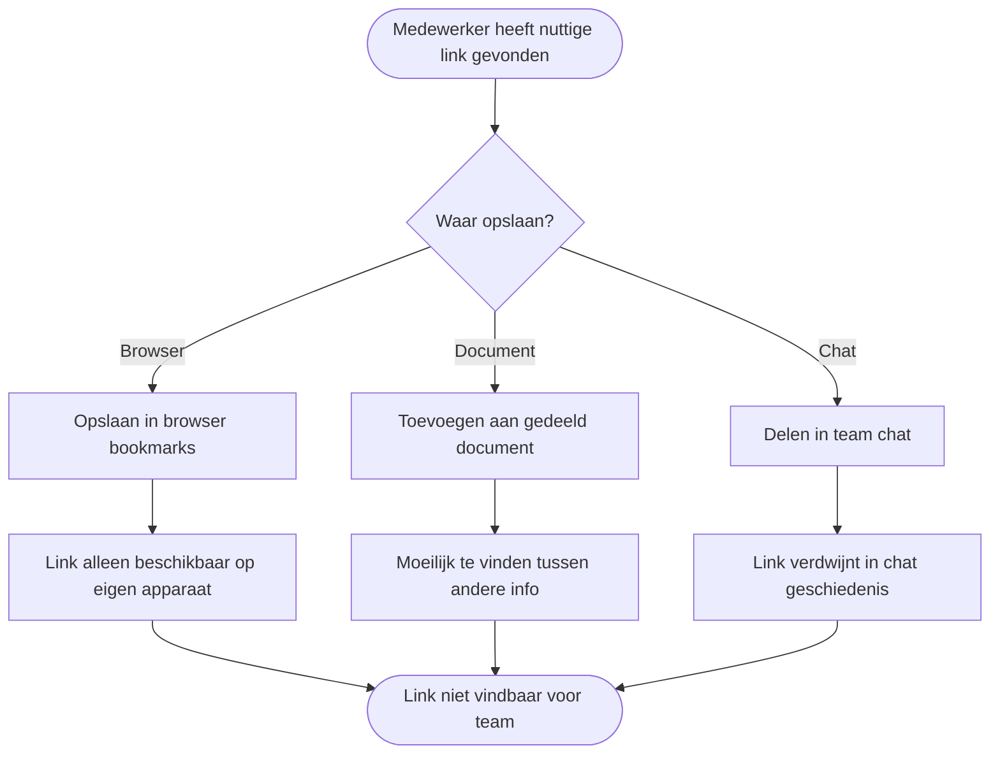
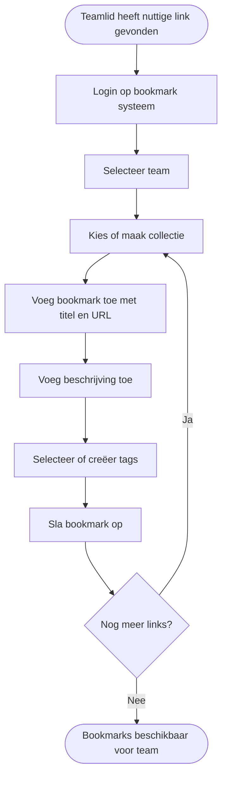
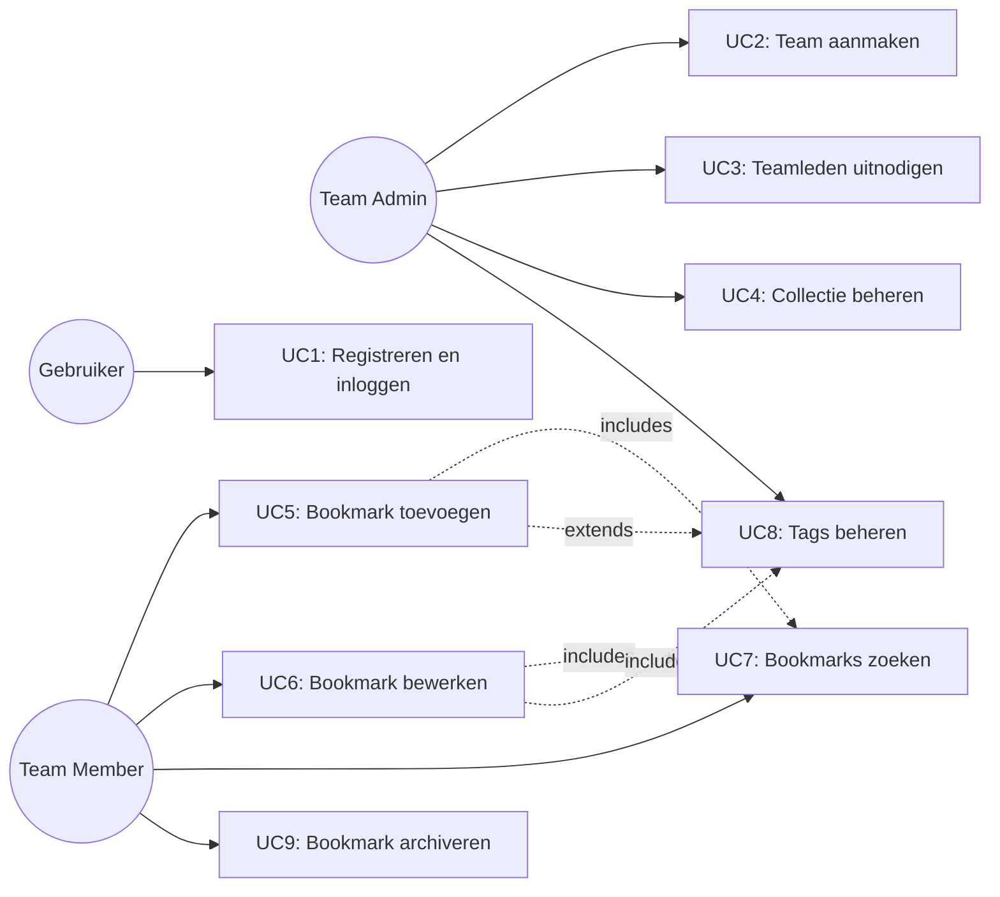
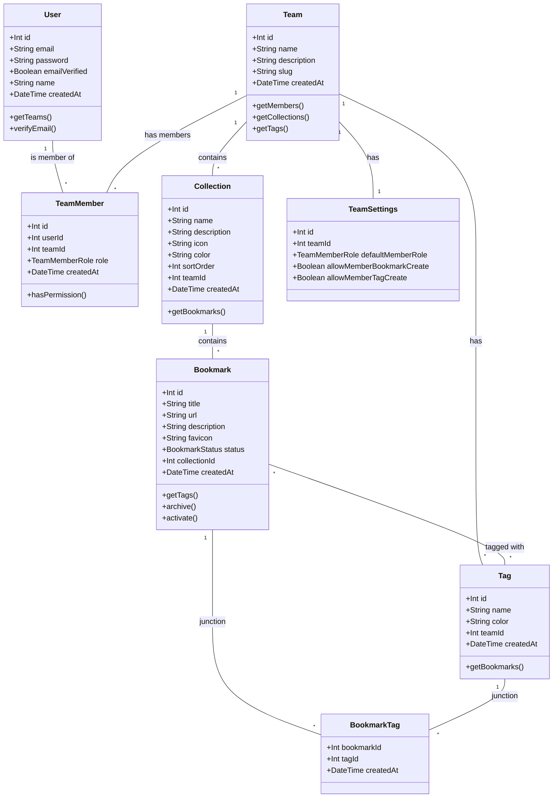
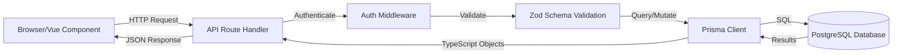
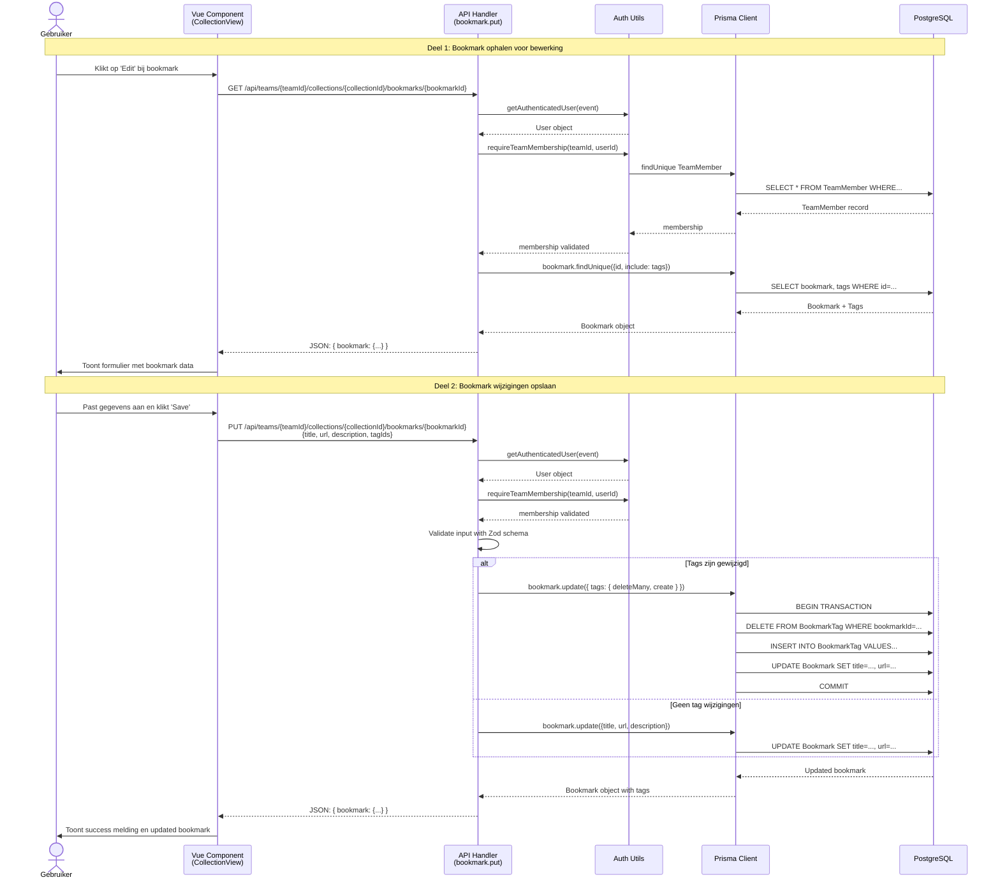
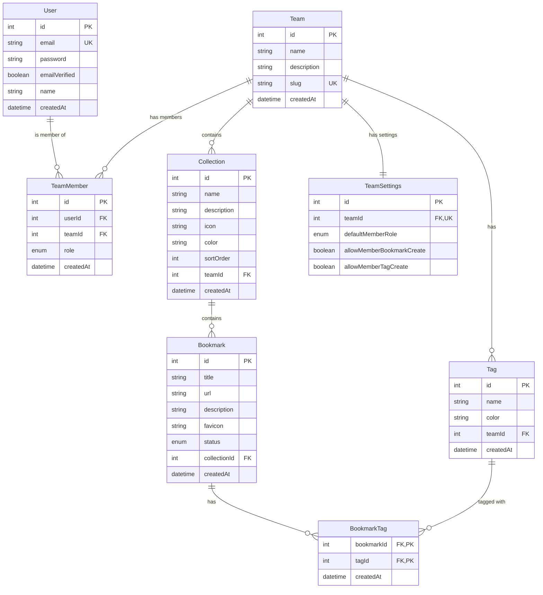
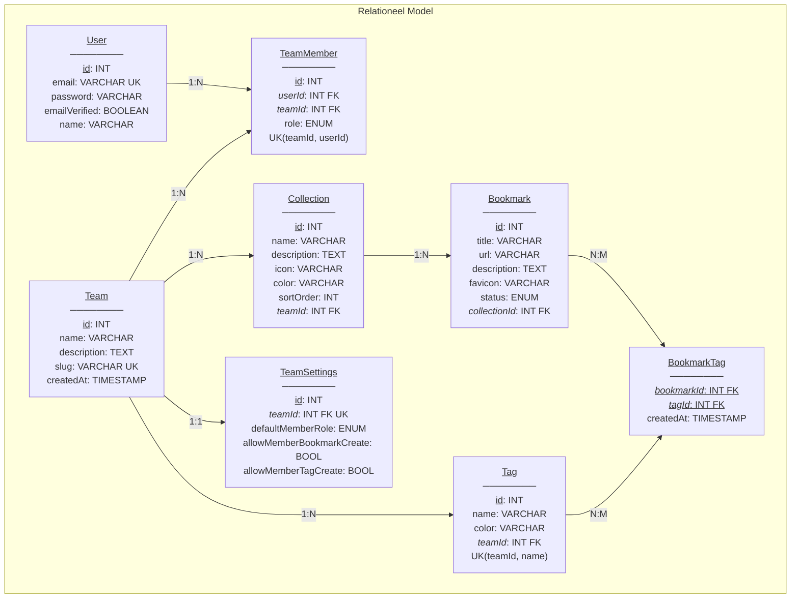

# Ontwerpen en bouwen van software

Een werkend voorbeeld: Team-based Bookmark Manager

- Koen van Vlimmeren
- Opleiding Informatica
- Academie voor Deeltijd
- Avans Hogeschool

02/01/2026

---

## Bedrijfsproces

### De huidige situatie

In veel bedrijven en teams verzamelen medewerkers nuttige weblinks en bronnen op verschillende manieren: in browserboekmarken, gedeelde documenten, e-mails of chatberichten. Dit leidt tot versnippering van kennis en maakt het moeilijk om relevante informatie terug te vinden. Teamleden hebben geen centraal overzicht van wat er al gevonden en gedeeld is.

Bij het zoeken naar een eerder gedeelde link, moet een medewerker door verschillende kanalen zoeken: oude chatberichten doorbladeren, in persoonlijke browserboekmarken kijken, of collega's vragen. Dit kost tijd en leidt tot duplicaat werk wanneer meerdere mensen dezelfde bronnen onafhankelijk van elkaar verzamelen.



> Figuur 1. Activiteitendiagram: het opslaan en delen van weblinks in de **huidige situatie**

### De gewenste situatie

Het doel is om een centraal systeem te creëren waar teams hun weblinks kunnen organiseren en beheren. Teamleden kunnen gezamenlijk collecties van bookmarks aanmaken en onderhouden. Een team owner of admin kan nieuwe collecties maken en teamleden beheren. Alle teamleden kunnen bookmarks toevoegen, bewerken en voorzien van tags voor betere vindbaarheid.

Elke bookmark heeft een status (ACTIVE of ARCHIVED), zodat verouderde links niet verwijderd hoeven te worden maar uit het zicht blijven. Tags maken het mogelijk om bookmarks te categoriseren over collecties heen, bijvoorbeeld alle 'tutorial' links of alle 'Vue.js' gerelateerde bronnen.



> Figuur 2. Activiteitendiagram: het toevoegen van een bookmark in de **nieuwe situatie**

---

## Requirements

Uit de bovenstaande beschrijving hebben we de volgende requirements afgeleid voor het team-based bookmark management systeem.

**Authenticatie & Gebruikers**
1. Een gebruiker kan zich registreren met e-mail en wachtwoord
2. Een gebruiker kan inloggen in het systeem
3. Een gebruiker moet zijn e-mail verifiëren voor toegang

**Team Management**
4. Een gebruiker kan een nieuw team aanmaken (wordt automatisch owner)
5. Een team owner kan andere gebruikers uitnodigen voor het team
6. Een team owner kan teamleden rollen toewijzen (OWNER, ADMIN, MEMBER)
7. Een team admin kan collecties en tags beheren
8. Een team member kan bookmarks bekijken en toevoegen (afhankelijk van instellingen)
9. Een gebruiker kan lid zijn van meerdere teams

**Collectie Management**
10. Een admin kan collecties aanmaken binnen een team
11. Een admin kan collecties bewerken (naam, beschrijving, icoon, kleur)
12. Een admin kan collecties verwijderen
13. Een gebruiker kan een overzicht van collecties per team krijgen

**Bookmark Management**
14. Een teamlid kan bookmarks toevoegen aan een collectie
15. Een teamlid kan bookmarks bewerken (titel, URL, beschrijving, status)
16. Een teamlid kan bookmarks archiveren (status naar ARCHIVED)
17. Een teamlid kan bookmarks verwijderen
18. Een teamlid kan bookmarks filteren op collectie
19. Een teamlid kan bookmarks filteren op tags
20. Een teamlid kan actieve en gearchiveerde bookmarks zien

**Tag Management**
21. Een teamlid kan tags aanmaken (afhankelijk van instellingen)
22. Een teamlid kan tags toewijzen aan bookmarks (meerdere tags per bookmark)
23. Een teamlid kan tags beheren (naam, kleur)
24. Een teamlid kan een overzicht van tags per team krijgen

De nummers die we aan de requirements geven, houden we zoveel mogelijk aan in de rest van het ontwerp. Dit is handig voor de [requirements traceability](https://en.wikipedia.org/wiki/Requirements_traceability). Je vindt de nummers rechtstreeks terug in de nummering van use-cases en bijbehorende testcases, of je gebruikt een [traceability matrix](https://en.wikipedia.org/wiki/Traceability_matrix).

---

## Use-cases

De gevonden requirements resulteren in een aantal use-cases. Het systeem ondersteunt drie hoofdrollen: gebruikers (voor authenticatie), team owners/admins (voor beheer), en team members (voor dagelijks gebruik). De belangrijkste use-cases zijn het beheren van teams en collecties, en het toevoegen en organiseren van bookmarks.



> Figuur 3. Use Case Diagram van het bookmark management systeem

> **Notities bij het Use Case Diagram:**
>
> (1) Om een bookmark te bewerken moet je deze eerst kunnen vinden in het systeem, vandaar de includes relatie met "Bookmarks zoeken".
>
> (2) Bij het toevoegen of bewerken van bookmarks kunnen tags worden toegevoegd. Het tag beheer kan apart gebruikt worden maar wordt vaak gecombineerd met bookmark acties.
>
> (3) Admins hebben alle rechten van Members, plus extra beheerfuncties voor collecties en team instellingen.

### Use-casebeschrijvingen

We werken enkele belangrijke use-cases uit in use-casebeschrijvingen.

#### Use Case 5: Bookmark toevoegen

| **Use-case**   | **Bookmark toevoegen**                                                                                        |
| -------------- | ------------------------------------------------------------------------------------------------------------- |
| Samenvatting   | Een teamlid voegt een nieuwe bookmark toe aan een collectie binnen het team.                                 |
| Voorwaarde     | Gebruiker is ingelogd en lid van een team. Het team heeft minimaal één collectie.                           |
| Stappen        | 1. Gebruiker selecteert het gewenste team uit de teamlijst                                                   |
|                | 2. Gebruiker navigeert naar de gewenste collectie                                                            |
|                | 3. Gebruiker klikt op 'Add Bookmark' knop                                                                    |
|                | 4. Systeem toont een formulier voor bookmark details                                                          |
|                | 5. Gebruiker vult titel en URL in (verplicht)                                                                 |
|                | 6. Gebruiker vult optioneel beschrijving in                                                                   |
|                | 7. Gebruiker selecteert optioneel één of meerdere tags                                                       |
|                | 8. Gebruiker klikt op 'Save'                                                                                  |
|                | 9. Systeem valideert de invoer                                                                                |
|                | 10. Systeem slaat de bookmark op met status ACTIVE                                                            |
|                | 11. Systeem toont de bookmark in de collectie lijst                                                           |
| Resultaat      | Een nieuwe bookmark is toegevoegd aan de collectie en zichtbaar voor alle teamleden.                         |
| Uitzonderingen | - Als titel of URL ontbreekt: foutmelding "Titel en URL zijn verplicht"                                     |
|                | - Als URL niet geldig is: foutmelding "Voer een geldige URL in"                                             |
|                | - Als gebruiker geen rechten heeft: foutmelding "Geen toestemming om bookmarks toe te voegen"               |

#### Use Case 6: Bookmark bewerken

| **Use-case**   | **Bookmark bewerken**                                                                                         |
| -------------- | ------------------------------------------------------------------------------------------------------------- |
| Samenvatting   | Een teamlid bewerkt een bestaande bookmark om details bij te werken of de status te wijzigen.               |
| Voorwaarde     | Er staan bookmarks in het systeem binnen de geselecteerde collectie.                                         |
| Stappen        | 1. Gebruiker zoekt een bookmark in de collectie (use-case 7)                                                 |
|                | 2. Gebruiker klikt op 'Edit' bij de bookmark                                                                  |
|                | 3. Systeem toont details van bookmark in een bewerkingsformulier                                              |
|                | 4. Gebruiker wijzigt titel, URL, beschrijving of status                                                       |
|                | 5. Gebruiker wijzigt de tags door tags toe te voegen of te verwijderen                                       |
|                | 6. Gebruiker klikt op 'Save'                                                                                  |
|                | 7. Systeem valideert de wijzigingen                                                                           |
|                | 8. Systeem slaat de wijzigingen op                                                                            |
|                | 9. Systeem toont de bijgewerkte bookmark                                                                      |
| Resultaat      | De bookmark is bijgewerkt met de nieuwe gegevens en wijzigingen zijn zichtbaar voor alle teamleden.          |
| Uitzonderingen | - Als titel of URL ontbreekt: foutmelding "Titel en URL zijn verplicht"                                     |
|                | - Als tag niet bij team hoort: foutmelding "Een of meer tags horen niet bij dit team"                       |
|                | - Als bookmark niet bestaat: foutmelding "Bookmark niet gevonden"                                            |

#### Use Case 7: Bookmarks zoeken

| **Use-case**   | **Bookmarks zoeken**                                                                                          |
| -------------- | ------------------------------------------------------------------------------------------------------------- |
| Samenvatting   | Een gebruiker zoekt bookmarks binnen een team op basis van collectie, tags of status.                        |
| Voorwaarde     | Gebruiker is lid van het team en het team bevat bookmarks.                                                   |
| Stappen        | 1. Gebruiker selecteert een team                                                                              |
|                | 2. Gebruiker kiest een collectie om bookmarks te filteren                                                     |
|                | 3. Systeem toont alle ACTIVE bookmarks in de geselecteerde collectie                                          |
|                | 4. Gebruiker kan optioneel filteren op tags                                                                   |
|                | 5. Gebruiker kan optioneel ook ARCHIVED bookmarks tonen                                                       |
|                | 6. Systeem toont gefilterde lijst met bookmarks                                                               |
| Resultaat      | Gebruiker ziet een gefilterde lijst van bookmarks die voldoen aan de zoekcriteria.                           |
| Uitzonderingen | - Als collectie leeg is: melding "Geen bookmarks in deze collectie"                                          |
|                | - Als geen bookmarks voldoen aan filter: melding "Geen bookmarks gevonden"                                   |

---

## Programmeren

Omdat we een objectgeoriënteerd systeem willen bouwen met TypeScript en Prisma ORM, gebruiken we Prisma models als data-abstractie laag. De Prisma Client genereert TypeScript types op basis van ons schema, wat type-safety door de hele applicatie garandeert.

We zorgen dat alle entiteiten correct gemodelleerd zijn met de juiste relaties en constraints. Het domeinmodel bestaat uit de volgende hoofdentiteiten:



> Figuur 4. Klassendiagram van het domeinmodel

In TypeScript met Prisma resulteert dit in models zoals:

```typescript
// Prisma automatisch gegenereerde types
type User = {
  id: number;
  name: string | null;
  email: string;
  emailVerified: boolean;
  password: string | null;
  createdAt: Date;
  updatedAt: Date;
  teamMemberships: TeamMember[];
}

type Team = {
  id: number;
  name: string;
  description: string | null;
  slug: string;
  members: TeamMember[];
  collections: Collection[];
  tags: Tag[];
  createdAt: Date;
  updatedAt: Date;
}

type Bookmark = {
  id: number;
  title: string;
  url: string;
  description: string | null;
  favicon: string | null;
  status: BookmarkStatus; // enum: ACTIVE | ARCHIVED
  collectionId: number;
  collection: Collection;
  tags: BookmarkTag[];
  createdAt: Date;
  updatedAt: Date;
}

type BookmarkTag = {
  bookmarkId: number;
  tagId: number;
  bookmark: Bookmark;
  tag: Tag;
  createdAt: Date;
}
```

### Voorbeeld API implementatie

De server-side API handlers gebruiken Prisma Client voor database operaties:

```typescript
// server/api/teams/[teamId]/collections/[collectionId]/bookmarks/index.post.ts
export default defineEventHandler(async (event) => {
  const user = await getAuthenticatedUser(event);
  const teamId = parseInt(getRouterParam(event, 'teamId') || '');
  const collectionId = parseInt(getRouterParam(event, 'collectionId') || '');

  // Verify user is a member
  const membership = await requireTeamMembership(event, teamId, user.id);

  // Check permissions based on team settings
  const settings = await prisma.teamSettings.findUnique({
    where: { teamId },
  });

  if (
    membership.role === TeamMemberRole.MEMBER &&
    settings &&
    !settings.allowMemberBookmarkCreate
  ) {
    throw createError({
      statusCode: 403,
      message: 'Members are not allowed to create bookmarks',
    });
  }

  const body = await readBody(event);
  const data = createBookmarkSchema.parse(body);

  // Create bookmark with tags
  const bookmark = await prisma.bookmark.create({
    data: {
      title: data.title,
      url: data.url,
      description: data.description,
      collectionId,
      tags: {
        create: data.tagIds.map((tagId) => ({ tagId })),
      },
    },
    include: {
      tags: {
        include: { tag: true },
      },
    },
  });

  return { bookmark };
});
```

Tijdens het programmeren zijn we tot verschillende inzichten gekomen. Zie de volledige documentatie en broncode op https://github.com/devkoenv/avans-doorstroom-informatica.

---

## Architectuur

We gebruiken een moderne variant van MVC (Model-View-Controller) specifiek voor Nuxt 3:

- **Model**: Prisma ORM schema definities en gegenereerde client
- **View**: Vue componenten in de `pages/` en `components/` directories
- **Controller**: Server API routes in de `server/api/` directory

Een gebruiker interacteert met Vue componenten in de browser. Deze componenten maken API calls naar de server endpoints. De server valideert de request, controleert authenticatie en autorisatie, voert business logic uit via Prisma ORM, en retourneert JSON responses. De Vue componenten verwerken deze responses en updaten de UI reactief.



> Figuur 5. Werking van onze Nuxt 3 architectuur

### Architectuur Eigenschappen

**Server-side (Nuxt Server/Nitro)**
* API routes volgen RESTful conventies met resourceful routing
* Authentication middleware controleert user session voor beschermde routes
* Authorization gebeurt op team membership en role niveau
* Prisma Client provides type-safe database access met auto-generated types
* Zod schemas valideren alle incoming request data

**Client-side (Vue 3 + Composition API)**
* Composables voor herbruikbare logica (useAuth, useTeam, etc.)
* Reactive state management met Vue's built-in reactivity
* Auto-imports voor componenten en composables
* Type-safe API calls met TypeScript
* Nuxt UI components voor consistente styling

**Database Layer**
* Prisma migrations voor schema version control
* Connection pooling voor performance
* Cascade deletes voor referential integrity
* Indexes voor query optimization
* Transactions voor atomic operations

### Sequencediagrammen

Hieronder is use case "UC6: Bookmark bewerken" uitgewerkt. Het diagram bestaat uit twee delen. Eerste helft: de gebruiker haalt de bookmark gegevens op en krijgt deze in een formulier gepresenteerd. Tweede helft: de gebruiker stuurt het ingevulde formulier naar de server, die de wijzigingen in de database doorvoert.



> Figuur 6. Sequentiediagram: Bookmark bewerken (Use Case 6)

---

## Data

### Entiteiten

We onderscheiden verschillende entiteiten in het systeem:

**User**: Gebruikers van het systeem met authenticatie gegevens.

**Team**: Een groep gebruikers die samen bookmarks organiseren. Elk team heeft een unieke slug voor URL routing.

**TeamMember**: De koppeling tussen een gebruiker en een team, inclusief de rol (OWNER, ADMIN, MEMBER). Dit is een associative entity die de many-to-many relatie tussen User en Team implementeert.

**Collection**: Een groepering van bookmarks binnen een team. Vergelijkbaar met mappen/folders. Heeft visuele eigenschappen (icoon, kleur) voor betere herkenbaarheid.

**Bookmark**: Een opgeslagen weblink met metadata. Heeft een status (ACTIVE of ARCHIVED) en kan tot één collectie behoren.

**Tag**: Een label voor categorisatie van bookmarks binnen een team. Kan aan meerdere bookmarks gekoppeld worden.

**BookmarkTag**: De koppeltabel die de many-to-many relatie tussen Bookmark en Tag implementeert.

**TeamSettings**: Configuratie instellingen per team voor toegangscontrole.



> Figuur 7. Entity Relationship Diagram voor het bookmark management systeem

### Relationeel Model

Het ERD wordt omgezet naar een relationeel model met de volgende tabellen. Primaire sleutels zijn <u>onderstreept</u>, vreemde sleutels zijn *cursief*.

**User**(<u>id</u>, email, password, emailVerified, name, createdAt, updatedAt)

**Team**(<u>id</u>, name, description, slug, avatar, createdAt, updatedAt)

**TeamMember**(<u>id</u>, *userId*, *teamId*, role, createdAt, updatedAt)
- FK userId REFERENCES User(id) ON DELETE CASCADE
- FK teamId REFERENCES Team(id) ON DELETE CASCADE
- UK (teamId, userId)

**Collection**(<u>id</u>, name, description, icon, color, sortOrder, *teamId*, createdAt, updatedAt)
- FK teamId REFERENCES Team(id) ON DELETE CASCADE

**Bookmark**(<u>id</u>, title, url, description, favicon, status, *collectionId*, createdAt, updatedAt)
- FK collectionId REFERENCES Collection(id) ON DELETE CASCADE

**Tag**(<u>id</u>, name, color, *teamId*, createdAt, updatedAt)
- FK teamId REFERENCES Team(id) ON DELETE CASCADE
- UK (teamId, name)

**BookmarkTag**(<u>*bookmarkId*, *tagId*</u>, createdAt)
- FK bookmarkId REFERENCES Bookmark(id) ON DELETE CASCADE
- FK tagId REFERENCES Tag(id) ON DELETE CASCADE
- Composite PK (bookmarkId, tagId)

**TeamSettings**(<u>id</u>, *teamId*, defaultMemberRole, allowMemberBookmarkCreate, allowMemberTagCreate, createdAt, updatedAt)
- FK teamId REFERENCES Team(id) ON DELETE CASCADE
- UK teamId



> Figuur 8. Relationeel model met referentiële integriteit

**Referentiële Integriteit:**
- **U:C** (Update Cascade): Niet expliciet nodig bij auto-increment integer keys
- **D:C** (Delete Cascade): Alle foreign keys hebben ON DELETE CASCADE
  - Team delete → verwijdert TeamMembers, Collections, Tags, TeamSettings
  - Collection delete → verwijdert Bookmarks (en dus ook BookmarkTags via cascade)
  - Bookmark delete → verwijdert BookmarkTags
  - Tag delete → verwijdert BookmarkTags
  - User delete → verwijdert TeamMembers

---

## De database

Het relationeel model wordt geïmplementeerd met PostgreSQL database. We gebruiken Prisma ORM voor schema definitie en migraties. Prisma genereert automatisch de DDL statements en houdt de database schema synchronized met onze code.

### Prisma Schema

```prisma
// Prisma schema file - schema.prisma

datasource db {
  provider = "postgresql"
  url      = env("DATABASE_URL")
}

generator client {
  provider = "prisma-client-js"
  output   = "./generated/prisma"
}

// Authentication models

model User {
  id                 Int                 @id @default(autoincrement())
  name               String?
  email              String              @unique
  emailVerified      Boolean             @default(false)
  password           String?
  image              String?
  teamMemberships    TeamMember[]
  createdAt          DateTime            @default(now())
  updatedAt          DateTime            @updatedAt
}

// Team-based Bookmark Manager Models

model Team {
  id          Int            @id @default(autoincrement())
  name        String
  description String?
  avatar      String?
  slug        String         @unique
  members     TeamMember[]
  collections Collection[]
  tags        Tag[]
  settings    TeamSettings?
  createdAt   DateTime       @default(now())
  updatedAt   DateTime       @updatedAt

  @@index([slug])
}

model TeamMember {
  id        Int            @id @default(autoincrement())
  team      Team           @relation(fields: [teamId], references: [id], onDelete: Cascade)
  teamId    Int
  user      User           @relation(fields: [userId], references: [id], onDelete: Cascade)
  userId    Int
  role      TeamMemberRole @default(MEMBER)
  createdAt DateTime       @default(now())
  updatedAt DateTime       @updatedAt

  @@unique([teamId, userId])
  @@index([userId])
  @@index([teamId])
}

enum TeamMemberRole {
  OWNER
  ADMIN
  MEMBER
}

model Collection {
  id          Int        @id @default(autoincrement())
  name        String
  description String?
  icon        String?    @default("folder")
  color       String?    @default("#6366f1")
  sortOrder   Int        @default(0)
  team        Team       @relation(fields: [teamId], references: [id], onDelete: Cascade)
  teamId      Int
  bookmarks   Bookmark[]
  createdAt   DateTime   @default(now())
  updatedAt   DateTime   @updatedAt

  @@index([teamId])
  @@index([teamId, sortOrder])
}

model Bookmark {
  id          Int              @id @default(autoincrement())
  title       String
  url         String
  description String?
  favicon     String?
  status      BookmarkStatus   @default(ACTIVE)
  collection  Collection       @relation(fields: [collectionId], references: [id], onDelete: Cascade)
  collectionId Int
  tags        BookmarkTag[]
  createdAt   DateTime         @default(now())
  updatedAt   DateTime         @updatedAt

  @@index([collectionId])
  @@index([status])
}

enum BookmarkStatus {
  ACTIVE
  ARCHIVED
}

model Tag {
  id        Int           @id @default(autoincrement())
  name      String
  color     String?       @default("#6366f1")
  team      Team          @relation(fields: [teamId], references: [id], onDelete: Cascade)
  teamId    Int
  bookmarks BookmarkTag[]
  createdAt DateTime      @default(now())
  updatedAt DateTime      @updatedAt

  @@unique([teamId, name])
  @@index([teamId])
  @@index([name])
}

model BookmarkTag {
  bookmark   Bookmark @relation(fields: [bookmarkId], references: [id], onDelete: Cascade)
  bookmarkId Int
  tag        Tag      @relation(fields: [tagId], references: [id], onDelete: Cascade)
  tagId      Int
  createdAt  DateTime @default(now())

  @@id([bookmarkId, tagId])
  @@index([bookmarkId])
  @@index([tagId])
}

model TeamSettings {
  id                        Int            @id @default(autoincrement())
  team                      Team           @relation(fields: [teamId], references: [id], onDelete: Cascade)
  teamId                    Int            @unique
  defaultMemberRole         TeamMemberRole @default(MEMBER)
  allowMemberBookmarkCreate Boolean        @default(true)
  allowMemberTagCreate      Boolean        @default(true)
  createdAt                 DateTime       @default(now())
  updatedAt                 DateTime       @updatedAt
}
```

### Gegenereerde SQL (PostgreSQL DDL)

Prisma genereert automatisch de volgende SQL statements tijdens migratie:

```sql
-- CreateEnum
CREATE TYPE "TeamMemberRole" AS ENUM ('OWNER', 'ADMIN', 'MEMBER');
CREATE TYPE "BookmarkStatus" AS ENUM ('ACTIVE', 'ARCHIVED');

-- CreateTable: User
CREATE TABLE "User" (
    "id" SERIAL PRIMARY KEY,
    "name" VARCHAR(255),
    "email" VARCHAR(255) UNIQUE NOT NULL,
    "emailVerified" BOOLEAN NOT NULL DEFAULT false,
    "password" VARCHAR(255),
    "image" VARCHAR(255),
    "createdAt" TIMESTAMP NOT NULL DEFAULT CURRENT_TIMESTAMP,
    "updatedAt" TIMESTAMP NOT NULL
);

-- CreateTable: Team
CREATE TABLE "Team" (
    "id" SERIAL PRIMARY KEY,
    "name" VARCHAR(255) NOT NULL,
    "description" TEXT,
    "avatar" VARCHAR(255),
    "slug" VARCHAR(255) UNIQUE NOT NULL,
    "createdAt" TIMESTAMP NOT NULL DEFAULT CURRENT_TIMESTAMP,
    "updatedAt" TIMESTAMP NOT NULL
);

-- CreateTable: TeamMember
CREATE TABLE "TeamMember" (
    "id" SERIAL PRIMARY KEY,
    "teamId" INTEGER NOT NULL,
    "userId" INTEGER NOT NULL,
    "role" "TeamMemberRole" NOT NULL DEFAULT 'MEMBER',
    "createdAt" TIMESTAMP NOT NULL DEFAULT CURRENT_TIMESTAMP,
    "updatedAt" TIMESTAMP NOT NULL,
    CONSTRAINT "TeamMember_teamId_fkey"
        FOREIGN KEY ("teamId") REFERENCES "Team"("id")
        ON DELETE CASCADE ON UPDATE CASCADE,
    CONSTRAINT "TeamMember_userId_fkey"
        FOREIGN KEY ("userId") REFERENCES "User"("id")
        ON DELETE CASCADE ON UPDATE CASCADE,
    CONSTRAINT "TeamMember_teamId_userId_key" UNIQUE ("teamId", "userId")
);

-- CreateTable: Collection
CREATE TABLE "Collection" (
    "id" SERIAL PRIMARY KEY,
    "name" VARCHAR(255) NOT NULL,
    "description" TEXT,
    "icon" VARCHAR(50) DEFAULT 'folder',
    "color" VARCHAR(7) DEFAULT '#6366f1',
    "sortOrder" INTEGER NOT NULL DEFAULT 0,
    "teamId" INTEGER NOT NULL,
    "createdAt" TIMESTAMP NOT NULL DEFAULT CURRENT_TIMESTAMP,
    "updatedAt" TIMESTAMP NOT NULL,
    CONSTRAINT "Collection_teamId_fkey"
        FOREIGN KEY ("teamId") REFERENCES "Team"("id")
        ON DELETE CASCADE ON UPDATE CASCADE
);

-- CreateTable: Bookmark
CREATE TABLE "Bookmark" (
    "id" SERIAL PRIMARY KEY,
    "title" VARCHAR(500) NOT NULL,
    "url" VARCHAR(2048) NOT NULL,
    "description" TEXT,
    "favicon" VARCHAR(2048),
    "status" "BookmarkStatus" NOT NULL DEFAULT 'ACTIVE',
    "collectionId" INTEGER NOT NULL,
    "createdAt" TIMESTAMP NOT NULL DEFAULT CURRENT_TIMESTAMP,
    "updatedAt" TIMESTAMP NOT NULL,
    CONSTRAINT "Bookmark_collectionId_fkey"
        FOREIGN KEY ("collectionId") REFERENCES "Collection"("id")
        ON DELETE CASCADE ON UPDATE CASCADE
);

-- CreateTable: Tag
CREATE TABLE "Tag" (
    "id" SERIAL PRIMARY KEY,
    "name" VARCHAR(100) NOT NULL,
    "color" VARCHAR(7) DEFAULT '#6366f1',
    "teamId" INTEGER NOT NULL,
    "createdAt" TIMESTAMP NOT NULL DEFAULT CURRENT_TIMESTAMP,
    "updatedAt" TIMESTAMP NOT NULL,
    CONSTRAINT "Tag_teamId_fkey"
        FOREIGN KEY ("teamId") REFERENCES "Team"("id")
        ON DELETE CASCADE ON UPDATE CASCADE,
    CONSTRAINT "Tag_teamId_name_key" UNIQUE ("teamId", "name")
);

-- CreateTable: BookmarkTag
CREATE TABLE "BookmarkTag" (
    "bookmarkId" INTEGER NOT NULL,
    "tagId" INTEGER NOT NULL,
    "createdAt" TIMESTAMP NOT NULL DEFAULT CURRENT_TIMESTAMP,
    CONSTRAINT "BookmarkTag_bookmarkId_fkey"
        FOREIGN KEY ("bookmarkId") REFERENCES "Bookmark"("id")
        ON DELETE CASCADE ON UPDATE CASCADE,
    CONSTRAINT "BookmarkTag_tagId_fkey"
        FOREIGN KEY ("tagId") REFERENCES "Tag"("id")
        ON DELETE CASCADE ON UPDATE CASCADE,
    PRIMARY KEY ("bookmarkId", "tagId")
);

-- CreateTable: TeamSettings
CREATE TABLE "TeamSettings" (
    "id" SERIAL PRIMARY KEY,
    "teamId" INTEGER UNIQUE NOT NULL,
    "defaultMemberRole" "TeamMemberRole" NOT NULL DEFAULT 'MEMBER',
    "allowMemberBookmarkCreate" BOOLEAN NOT NULL DEFAULT true,
    "allowMemberTagCreate" BOOLEAN NOT NULL DEFAULT true,
    "createdAt" TIMESTAMP NOT NULL DEFAULT CURRENT_TIMESTAMP,
    "updatedAt" TIMESTAMP NOT NULL,
    CONSTRAINT "TeamSettings_teamId_fkey"
        FOREIGN KEY ("teamId") REFERENCES "Team"("id")
        ON DELETE CASCADE ON UPDATE CASCADE
);

-- CreateIndex
CREATE INDEX "Team_slug_idx" ON "Team"("slug");
CREATE INDEX "TeamMember_userId_idx" ON "TeamMember"("userId");
CREATE INDEX "TeamMember_teamId_idx" ON "TeamMember"("teamId");
CREATE INDEX "Collection_teamId_idx" ON "Collection"("teamId");
CREATE INDEX "Collection_teamId_sortOrder_idx" ON "Collection"("teamId", "sortOrder");
CREATE INDEX "Bookmark_collectionId_idx" ON "Bookmark"("collectionId");
CREATE INDEX "Bookmark_status_idx" ON "Bookmark"("status");
CREATE INDEX "Tag_teamId_idx" ON "Tag"("teamId");
CREATE INDEX "Tag_name_idx" ON "Tag"("name");
CREATE INDEX "BookmarkTag_bookmarkId_idx" ON "BookmarkTag"("bookmarkId");
CREATE INDEX "BookmarkTag_tagId_idx" ON "BookmarkTag"("tagId");
```

### Database Beheer Commando's

```bash
# Prisma schema syncen met database
npm run db:generate

# Nieuwe migratie maken
npm run db:migrate

# Database seeden met test data
npm run db:seed

# Prisma Studio openen (database GUI)
npx prisma studio
```

---

## Conclusie

Dit document beschrijft het ontwerp en de implementatie van een team-based bookmark management systeem. Het systeem is gebouwd met moderne web technologieën (Nuxt 3, Vue 3, TypeScript, Prisma ORM, PostgreSQL) en volgt gevestigde software engineering principes.

De belangrijkste ontwerpbeslissingen zijn:
- Team-gebaseerde isolatie voor multi-tenancy
- Many-to-many relatie tussen Bookmarks en Tags voor flexibele categorisatie
- Role-based access control met drie niveaus (OWNER, ADMIN, MEMBER)
- Soft delete via status enum (ACTIVE/ARCHIVED) voor data preservatie
- RESTful API design met resourceful routing
- Type-safe development met TypeScript en Prisma

Het systeem is volledig functioneel en gedocumenteerd op GitHub: https://github.com/DevKoenv/avans-doorstroom-informatica

---

*Dit document is opgesteld volgens de richtlijnen voor het vak "Ontwerpen en bouwen van software" aan de Avans Hogeschool.*